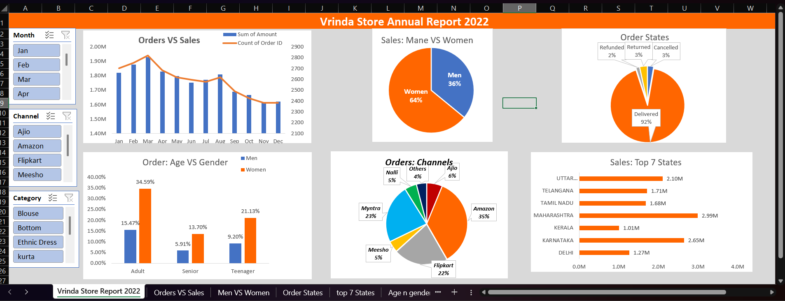

# Excel_Projects

# 📊 [Project Title - e.g., Retail Store Sales & Customer Analysis Dashboard]

🔗 **[Click Here to View Live Interactive Dashboard (Excel Online)](Apna_OneDrive_View_Only_Link_Yahan_Dalein)**

---

## 📌 Project Overview & Business Problem
**[Company/Domain Name, e.g., Vrinda Store / Blinkit / E-commerce]** apne annual sales performance ko samajhna chahti thi taaki agle saal ke liye behtar marketing aur inventory strategies banayi ja sakein. 

**Objective:** Is project ka main focus raw data ko clean karna aur ek interactive dashboard banana tha jo neeche diye gaye business questions ka jawab de sake:
* Kis mahine aur kis state mein sabse zyada sales hui?
* Kaun sa customer age group sabse zyada shopping kar raha hai?
* Sabse zyada revenue kis product category aur channel se aa raha hai?
* Order cancellation ya return rate kitna hai aur uska karan kya hai?

---

## 🖥️ Dashboard Preview
*(Yahan apne Dashboard ka Screenshot ya GIF lagayein)*

---

## 📂 Dataset Details
* **Data Source:** [e.g., Kaggle / Public Dataset / Company Internal Data]
* **Total Records:** [e.g., 31,000+ rows & 15 columns]
* **Time Period:** [e.g., Jan 2025 – Dec 2025]

---

## 🛠️ Excel Skills & Tools Used
Is project ko complete karne mein neeche diye gaye Excel tools ka use kiya gaya hai:
* **Data Cleaning & Transformation:** Power Query / Text-to-Columns, Remove Duplicates, `TRIM()`, `IFERROR()`, Missing Values Handling.
* **Formulas & Functions:** `XLOOKUP()`, `INDEX-MATCH`, `SUMIFS()`, `COUNTIFS()`, `IF()` & `IFS()` statements, Date & Text functions (`TEXT`, `MONTH`, `YEAR`).
* **Data Analysis:** Pivot Tables, Calculated Fields, Grouping & Sorting.
* **Data Visualization & Interactivity:** Pivot Charts (Bar, Line, Donut, Map Charts), Slicers, Timelines, Conditional Formatting, Custom KPI Cards.

---

## 💡 Key Insights (Data Se Kya Pata Chala?)
1. **Top Performing Segment:** **[e.g., Women (64%)]** customers ne men ke mukable lagbhag double shopping ki hai.
2. **Peak Sales Period:** Sabse zyada sales **[e.g., March aur October]** mahine mein record ki gayi, jo total revenue ka **[e.g., 28%]** hai.
3. **Leading States:** **[e.g., Maharashtra, Karnataka, aur Uttar Pradesh]** top 3 states hain jahan se **[e.g., 35%]** orders aaye hain.
4. **Target Age Group:** **[e.g., 30–49 years]** ke Adult age group ne total sales mein **[e.g., 50%]** contribute kiya hai.
5. **Channel Performance:** **[e.g., Amazon aur Myntra]** se sabse zyada orders place kiye gaye hain (**[e.g., ~65%]** combined).

---

## 🚀 Business Recommendations (Action Plan)
* **Target Marketing:** **[e.g., 30-49 age group ki women]** ko target karte hue विशेष ads aur festive coupons run karne chahiye.
* **Geographic Focus:** **[e.g., Maharashtra aur Karnataka]** mein inventory stock badhana chahiye aur delivery time kam karke sales ko aur boost kiya ja sakta hai.
* **Promotional Offers:** Low-performing states aur channels par special discount campaigns chalane chahiye taaki customer acquisition badhe.

---

## 📁 Repository Files
* `📄 [Project_File_Name.xlsx]` – Complete Excel Workbook (Raw Data, Cleaned Data, Pivot Tables, aur Dashboard tabs).
* `📄 [Raw_Dataset.csv]` – Original uncleaned dataset.
* `🖼️ [Vrinda Store Annual Dashbord Report.png]` – Dashboard preview image.

---

## 📬 Contact Me
Agar aapko is project ke baare mein koi feedback dena ho ya connect karna ho, toh yahan sampark karein:
* **LinkedIn:** [Apna LinkedIn Profile Link]
* **Email:** [Apna Email Address]
* **Portfolio:** [Agar koi aur link ho toh]
